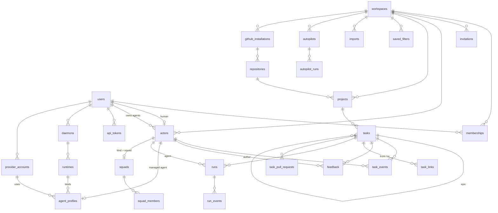

# 01 · 数据模型

> 全部表集中在这里，各功能文档只引用。主键一律 `bigserial`；对外 ID 是项目 Key + 序号（`BOS-12`）、Feedback 是 `BOS-12#3`，不暴露自增主键。

## 1. ER 图

## 2. 表

### 账号与工作区（02）

| 表 | 列 | 约束 / 索引 |
|---|---|---|
| `users` | `email citext`、`hashed_password`、`confirmed_at`、`display_name`、`instance_admin bool`、时间戳 | phx.gen.auth 生成；`email` 唯一；`instance_admin` 只用于 LiveDashboard 等实例级运维（11 §3），与工作区角色无关 |
| `users_tokens` | phx.gen.auth 生成（会话、magic link、改邮箱） | |
| `workspaces` | `slug citext`、`name`、时间戳 | `slug` 唯一，`^[a-z0-9][a-z0-9-]{1,38}$` |
| `memberships` | `workspace_id`、`user_id`、`role`、时间戳 | 唯一 `(workspace_id, user_id)`；`role IN (owner, admin, member, viewer)` |
| `invitations` | `workspace_id`、`email`（可空 = 通用链接）、`role`、`token_hash`、`invited_by_id`、`expires_at`、`accepted_at`、`accepted_by_id`、`revoked_at`、`revoked_by_id` | `token_hash` 唯一；可撤销（`add-invitations-members`） |

### 身份（03）

| 表 | 列 | 约束 / 索引 |
|---|---|---|
| `actors` | `workspace_id`、`kind`（human \| agent \| squad \| system）、`name citext`、`user_id`（human：对应用户）、`owner_id`（agent：所属用户）、`project_key`、`worktree`、`disabled_at`、`last_seen_at`、时间戳 | 唯一 `(workspace_id, name)`；部分唯一 `(workspace_id, user_id) WHERE kind = 'human'`；部分唯一 `(workspace_id) WHERE kind = 'system'`；CHECK：agent 必有 `owner_id` 且 `user_id` 为空。human 的 `user_id` 可以为空——导入时产生的「未认领」身份，不能登录也不能写入（11 §1.2） |
| `avatars` | `user_id`（人的头像，挂在用户上，跨工作区共用）或 `workspace_id` + `actor_id`（Agent / 小队的头像，复合外键 → `actors`）；两种形式二选一：**图片**（`content_type` png \| jpeg \| webp、`data bytea`、`key`（`data` 的 sha256 前 32 位十六进制，对外读取键）、`byte_size` ≤ 256 KB、`edge` 32–1024 px）或**内置图标**（`icon`，`^[a-z0-9]{1,32}$`，图片各列为空）；`updated_by_id`、时间戳 | 唯一 `user_id`、唯一 `actor_id`；CHECK：`user_id` 与 `actor_id` 恰好一个非空、`workspace_id` 与 `actor_id` 同时为空或非空、`avatars_form`（图片列全非空且 `icon` 为空，或反之）；索引 `(workspace_id, key)`、`key WHERE user_id IS NOT NULL`。系统身份与未认领的人没有头像；不随工作区导出（`add-actor-avatars`、`update-actor-icons`） |
| `api_tokens` | `workspace_id`、`user_id`、`name`、`token_hash`、`prefix`、`scopes text[]`、`default_agent_id`、`last_used_at`、`expires_at`、`revoked_at`、时间戳 | `token_hash` 唯一 |

### Agent 执行（12–16）

| 表 | 列 | 约束 / 索引 |
|---|---|---|
| `agent_profiles` | 只有托管 Agent 有这一行。`workspace_id`、`actor_id`、`provider`、`runtime_id`、`model`、`effort`、`instructions`、`description`、`access`、`access_member_ids bigint[]`、`capabilities text[]`、`max_concurrency`、`timeout_minutes`、`idle_timeout_minutes`、`custom_args text[]`、`env`（加密）、`extra_mcp_servers`（加密）、`provider_account_id`（可空，`add-provider-accounts`）、`wake_on_requested bool`（缺省 true，`add-continuation-triggers`）、`archived_at`、时间戳 | 唯一 `actor_id`；`provider_account_id` → `provider_accounts`（`ON DELETE RESTRICT`）；详见 12 §2 |
| `provider_accounts` | `user_id`、`name citext`、`cli`（claude \| codex）、`base_url`、`api_key`（加密，只写）、`models jsonb`、`header_names text[]` 与 `headers`（加密，只写；只限 codex，`add-provider-account-headers`）、`icon`（可空，`^[a-z0-9]{1,32}$`，界面的厂商图标；空 = 按 base URL 推断，`add-actor-avatars`）、时间戳 | 唯一 `(user_id, name)`；不属于某个工作区；每人最多 32 个；详见 12 §2.2 |
| `daemons` | `user_id`、`machine_id`、`name`、`os`、`arch`、`version`、`protocol_version`、`token_hash`、`token_issued_at`、`previous_token_hash`、`previous_token_expires_at`、`auth_epoch`（授权代次）、`max_concurrency`、`last_seen_at`、`revoked_at`、`repo_registration`（是否允许网页登记本地仓库，守护进程上报，15 §8）、时间戳 | 唯一 `(user_id, machine_id)`、`token_hash`、部分唯一 `previous_token_hash`；不属于某个工作区 |
| `daemon_workspaces` | `daemon_id`、`workspace_id` | 主键 `(daemon_id, workspace_id)`；登录时勾选的工作区（12 §3.1），领取只能领这些工作区的运行 |
| `device_codes` | `device_code_hash`、`user_code`、`machine jsonb`、`protocol_version`、`user_id`（确认后填）、`workspace_ids bigint[]`、`status`（pending \| approved \| denied \| used \| expired）、`interval`、`last_polled_at`、`expires_at` | 设备码登录（12 §3.1），10 分钟过期；部分唯一 `user_code WHERE status IN (pending, approved)`（发码前先把过期的置 `expired`） |
| `runtimes` | `workspace_id`、`daemon_id`、`provider`、`cli_version`、`models text[]`、`efforts text[]`、`status`、`unavailable_reason`、`disabled_at`、`vendor`（守护进程推断的厂商键，可空，`^[a-z0-9]{1,32}$`；只存服务端认识的键，断线离线时不改，12 §3.2）、时间戳 | 唯一 `(workspace_id, daemon_id, provider)` |
| `runs` | 见 13 §1；另有 `provider_account_id`（领取时所用的供应商账号，→ `provider_accounts`，`ON DELETE SET NULL`，`add-provider-accounts`） | 部分唯一 `(task_id, agent_id, lane, coalesce(squad_id, 0)) WHERE status IN ('deferred','queued')`；唯一 `retry_of_id`；索引 `(runtime_id, status, priority DESC, not_before, inserted_at, id)`、`(task_id, inserted_at DESC)`、`(agent_id, status)`、`(daemon_id, status)` |
| `run_tokens` | `run_id`、`token_hash`、`expires_at`、`revoked_at` | `run_id`、`token_hash` 唯一；运行进入终态时吊销 |
| `task_grants` | `workspace_id`、`task_id`、`agent_id`（授权目标：托管 Agent，执行方是小队时为小队身份）、`kind`（assign \| requested）、`squad_id`（可空：小队的指派授权、leader 运行里建任务的提出方授权，`add-squads`）、`root_initiator_user_id`、`causal_agent_ids`、`granted_by_id`、`inserted_at` | 唯一 `(task_id, agent_id, kind)`；延续触发继承授权的来源（13 §2.2）；执行方变化时作废 `assign`；`requested` = 托管 Agent 在运行中建任务时记下的提出方授权，不作废；不设 `delegate`（`add-squads` 决策 2） |
| `run_events` | `run_id`、`seq`、`type`、`data jsonb`、`at` | 主键 `(run_id, seq)`；不分区，运行结束 30 天后按运行整块删除（13 §1） |
| `run_steers` | `workspace_id`、`run_id`、`feedback_id`、`sent_at`、`acked_at`（守护进程回执，可空） | 主键 `(run_id, feedback_id)`；索引 `feedback_id`；一行 = 推送过的插话，`acked_at` 即回执（13 §8，`add-run-steering`） |
| `agent_designs` | `workspace_id`、`user_id`、`helper_agent_id`、`kind`（agent；小队加 squad）、`status`（open \| confirmed \| discarded \| expired）、`draft jsonb`、`draft_version`、`pending_edits jsonb`（还没告诉 AI 的用户修改）、`current_run_id`、`user_messages`、`created_actor_ids bigint[]`、`last_activity_at`、`closed_at`、时间戳 | 部分唯一 `(workspace_id, user_id) WHERE status = 'open'`、`current_run_id WHERE NOT NULL`；对话创建 Agent（12 §6，`add-agent-conversation` 决策 3）；关闭 30 天后删除 |
| `agent_design_messages` | `design_id`、`seq`、`role`（user \| assistant \| system）、`content`、`edits jsonb`（用户消息：发送时 `pending_edits` 的快照）、`code` / `detail`（系统消息）、`run_id`、`inserted_at` | 唯一 `(design_id, seq)`；部分唯一 `run_id WHERE role <> 'user'`（结算幂等） |
| `squads` / `squad_members` | 见 16 §1.1：`squads` 另有 `description`（≤ 500 字符）、`lock_version`；`squad_members` 另有 `position`（显示顺序）、`role_note` ≤ 500 字符；停用 = 小队身份的 `disabled_at` | `squads.actor_id` 唯一、`leader_agent_id` 索引；`squad_members` 主键 `(squad_id, actor_id)`、索引 `actor_id`；成员名单只在持有 `squads` 行 `FOR UPDATE` 时修改 |
| `autopilots` / `autopilot_runs` | 见 16 §2.1（`add-autopilots` 决策 1） | `autopilots` 唯一 `(workspace_id, name)`；CHECK 建任务模式必有项目与标题模板、停用时 `next_run_at` 为空；`autopilot_runs` 部分唯一 `(autopilot_id) WHERE status = 'started'`、`(autopilot_id) WHERE status = 'pending'`、`run_id WHERE run_id IS NOT NULL`；唯一 `(autopilot_id, delivery_id)`（永久去重）、`(autopilot_id, scheduled_for)`；`skipped` 记录保留 30 天 |
| `github_apps` | `app_id`、`slug`、`name`、`html_url`、`owner_login`、`client_id`、`client_secret`（加密）、`private_key`（加密）、`webhook_secret`（加密）、`created_by_id`、时间戳 | 实例级单行（15 §1）；环境变量配置时不用这张表 |
| `github_installations` | `workspace_id`、`installation_id`、`account_login`、`account_type`、`suspended_at`、`disconnected_at`、`fetched_at`、`repos_fetched_at`、时间戳 | 唯一 `installation_id`（一个安装只属于一个工作区）；两个 `*_fetched_at` 是最近一次被应用的 GitHub 读取结果的抓取时刻，更早抓取的结果不再写入（webhook 只触发重新读取，15 §1） |
| `repositories` | `workspace_id`、`installation_id`、`github_id`、`owner`、`name`、`default_branch`、`archived`、`private`、`removed_at`、时间戳 | 唯一 `(workspace_id, github_id)`；`removed_at` = 不再在安装范围内或安装已断开（保留行，项目绑定不丢） |
| `local_repositories` | `workspace_id`、`daemon_id`、`name`、`path`（只用于显示）、`default_branch`、`status`（online \| offline \| unavailable）、`unavailable_reason`、`removed_at`、时间戳 | 唯一 `(workspace_id, daemon_id, name)`；守护进程按机器上的配置上报（15 §8） |
| `task_local_branches` | `workspace_id`、`task_id`、`local_repository_id`、`branch`、`head_sha`、`state`（open \| merged）、`merged_at`、`merged_by_id`、`merge_note`、时间戳 | 唯一 `task_id`；本地仓库模式的合并状态（15 §8） |
| `local_repository_changes` | `daemon_id`、`user_id`（操作者）、`workspace_id`（发起的工作区）、`action`（register \| remove）、`name`、`root`、`path`（登记时：根目录标签与相对路径）、`workspace_ids bigint[]`（涉及的工作区）、`request_id`、`status`（pending \| succeeded \| failed）、`error`、`message`、`inserted_at`、`completed_at` | 唯一 `request_id`；网页登记 / 移除本地仓库的操作记录（15 §8），不随工作区导出 |
| `task_pull_requests` | 15 §3 的列，另有 `node_id`、`base_branch`、`merged_at`、`checks jsonb`（当前头部的检查计数与失败检查名，`add-pr-reconcile-merge` 决策 22）、`included_sha`（确认包含在合并内容里的最近交付，`add-pr-reconcile-merge` 决策 21）、`closed_by_helmsman`、`draft_supported`、`waiting_since`、`merge_request jsonb`（立即合并的请求）、`escalated_event_id`、`branch_deleted_at`、`rescue_cleaned_at`、`reconciled_at`（`add-pr-reconcile-merge` 决策 2） | 唯一 `(repository_id, number)`；索引 `(task_id, id)`：一个任务可有多行，当前 PR = `id` 最大的一行；部分索引 `(repository_id, head_sha) WHERE state IN ('draft','open')` |
| ~~`task_branches`~~ | 不建：任务分支名确定（`hm/<工作区 ID>/<ident 小写>`），推送记录、出处、救援分支都在 `runs` 的推送列上（13 §1，`add-daemon-git-workspace` 决策 1） | — |
| `github_deliveries` | `delivery_id`、`received_at` | 主键 `delivery_id`；webhook 去重，保留 7 天 |

`projects` 增加：`repository_id`、`base_branch`、`merge_policy`、`merge_method`、`require_ci`、`delete_branch_after_merge`（15 §4）。

### 任务域（04–07）

| 表 | 列 | 约束 / 索引 |
|---|---|---|
| `projects` | `workspace_id`、`key`、`name`、`description`、`task_seq int`、`archived_at`、时间戳 | 唯一 `(workspace_id, key)`；`key ~ '^[A-Z][A-Z0-9]{1,9}$'` |
| `tasks` | `workspace_id`、`project_id`、`seq`、`ident`（`BOS-12`，冗余）、`title`、`description`、`status`、`priority`、`kind`、`labels text[]`、`epic_id`、`created_by_id`、`assignee_id`、`feedback_seq int`、`feedback_count int`、`open_question bool`、`lock_version int`、`search tsvector`（GIN 索引；Ecto 字段 `load_in_query: false`，`add-fulltext-search`）、时间戳 | 唯一 `(project_id, seq)`、`(workspace_id, ident)`；GIN `labels`、GIN `search`、GIN trigram（`gin_trgm_ops`）`title` 与 `ident`；索引 `(workspace_id, status)`、`(workspace_id, updated_at DESC)`、`epic_id`、`assignee_id`；CHECK `kind IN ('task','epic')`、`kind = 'epic' → epic_id IS NULL`、`epic_id <> id`；`epic_id` 为部分索引（`WHERE epic_id IS NOT NULL`）；`kind`、`epic_id` 随 `add-epics` 加列 |
| `task_events` | `workspace_id`、`task_id`、`from_status`（创建时为空）、`to_status`、`actor_id`、`comment`、`commits text[]`、`tests jsonb`、`auto bool`、`auto_reason`（自动重开的原因 `ci_failed` \| `merge_conflict`，`add-continuation-triggers`）、`feedback_id`、`source_run_id`、`verified_sha`、`assignee_side_ids bigint[]`（迁移到 `verified` 的事件记下当时的执行方一侧，`add-squads` 决策 11）、`inserted_at` | 索引 `(task_id, inserted_at)`；只插入，不更新；部分唯一 `(source_run_id) WHERE auto AND from_status = 'new' AND to_status = 'in_progress'`（只有运行开始时的自动领取会产生这种事件，保证它幂等，13 §4.4；同一运行里的 Epic 级联、替代撤销等其他自动事件不受限）。`source_run_id`、`verified_sha` 在派发（M5）/ GitHub（M6）的变更里加列 |
| `feedback` | `workspace_id`、`task_id`、`seq`、`thread_seq`、`author_id`、`kind`、`content`、`mentions bigint[]`、`status`（active \| superseded）、`supersedes_id`、`superseded_by_id`、`source_run_id`、`fallback bool`、`dispatch jsonb`（这条记录引起的触发结果，`add-continuation-triggers`）、`search tsvector`（GIN 索引；Ecto 字段 `load_in_query: false`，`add-fulltext-search`）、`inserted_at` | 唯一 `(task_id, seq)`；GIN `search`；`thread_seq` 见 06 §3，`mentions` 见 06 §3a；`source_run_id` = 用运行令牌写入时所在的运行（自动填）；`fallback` = 服务端代写的兜底回帖（13 §7），部分唯一 `(source_run_id) WHERE fallback`。`source_run_id`、`fallback` 在 M5 加列、`search` 在 M10 加列 |
| `task_links` | `workspace_id`、`from_task_id`、`to_task_id`、`type`（replaces \| depends_on）、`actor_id`、`inserted_at` | 主键 `(from_task_id, to_task_id, type)`；CHECK `from <> to`；索引 `to_task_id` |
| `saved_filters` | `workspace_id`、`owner_id`（user）、`name citext`（≤ 80 个字符）、`bql`（≤ 2000 个字符）、`visibility`（private \| workspace）、`lock_version`、时间戳 | 唯一 `(workspace_id, owner_id, name)`；每人每工作区最多 100 个（`add-bql-filters` 决策 10） |
| `imports` | `workspace_id`、`user_id`（`SET NULL`）、`mode`（merge \| replace）、`dry_run`、`source`（helmsman \| bosun）、`file_sha256`、`file_name`、`status`（queued \| running \| succeeded \| failed）、`report jsonb`、`errors jsonb`、`upload`（数据目录里的上传文件，处理完置空）、`started_at`、`finished_at`、时间戳 | 每次导入（含试运行与失败的）一条审计记录，永久保留（11 §1.2，`add-export-import`） |
| `exports` | `workspace_id`、`user_id`（发起人，CASCADE）、`status`、`file`（数据目录里的相对名）、`size`、`sha256`、`counts jsonb`、`error`、`expires_at`、时间戳 | 只给发起人下载，完成 24 小时后连同文件删除（11 §1.1） |
| `actor_claims` | `workspace_id`、`actor_id`（未认领的 human，CASCADE）、`user_id`（申请人，CASCADE）、`status`（pending \| approved \| rejected \| cancelled）、`decided_by_id`、`decided_at`、时间戳 | 部分唯一 `(actor_id, user_id) WHERE status = 'pending'`；批准即合并（11 §1.2） |

说明：

- **`tasks.ident` 冗余存储**：项目 Key 不可改，所以 `KEY-N` 是稳定的；按 ID 查找、BQL `id ~`、导出都不用 join。
- **`feedback_count` / `open_question` 冗余存储**：在写 Feedback 的同一事务里维护，BQL 可以直接按列过滤和排序。
- **`progress`、`blocked`、`links` 不落库**，查询时派生（04、07）。
- 枚举列（`status` `priority` `kind` `role` …）是 `text` + CHECK，Elixir 侧 `Ecto.Enum`。
- `labels` 的 BQL 条件编译成 `labels @> ARRAY[$1]`（能用上 GIN），不用 `$1 = ANY(labels)`。

## 3. 租户隔离：数据库层保证

只靠「每个查询都带 `workspace_id`」不够：漏一个条件或导入一条坏数据就会串数据。所以引用关系在**数据库里**就限定在同一工作区：

- **每张带 `workspace_id` 的表**都加唯一约束 `(workspace_id, id)`，作为复合外键的目标（PostgreSQL 要求被引用的列组合有唯一约束）；
- 所有跨表引用用**复合外键**，例如：

| 引用 | 复合外键 |
|---|---|
| 任务 → 项目 / Epic / 提出方 / 执行方 | `(workspace_id, project_id)`、`(workspace_id, epic_id)`、`(workspace_id, created_by_id)`、`(workspace_id, assignee_id)` |
| 事件 → 任务 / actor / Feedback | `(workspace_id, task_id)`、`(workspace_id, actor_id)`、`(workspace_id, feedback_id)` |
| Feedback → 任务 / 作者 / 修订链 | `(workspace_id, task_id)`、`(workspace_id, author_id)`、`(workspace_id, supersedes_id)` … |
| 链 → 两端任务 / actor | `(workspace_id, from_task_id)`、`(workspace_id, to_task_id)`、`(workspace_id, actor_id)` |
| Token → 默认 Agent | `(workspace_id, default_agent_id)` |
| 运行 → 任务 / Agent / 运行时；Agent 配置 → 运行时；PR / 分支 → 任务 / 仓库；仓库 → 安装 | `(workspace_id, task_id)`、`(workspace_id, agent_id)`、`(workspace_id, runtime_id)`、`(workspace_id, repository_id)`、`(workspace_id, installation_id)` |

这样即使应用层漏了条件，也写不出跨工作区的引用。数据库表达不了的规则（Token 的默认 Agent 必须属于 Token 的用户、Agent 未停用、`epic_id` 指向的是 `kind = epic`、Agent 只能绑定所属用户自己的运行时，12 §3.3；Agent 只能绑定所属用户自己的、CLI 相同的供应商账号，12 §2.2）在写入事务里校验。

## 4. 事务与加锁

多用户之后会出现并发写（bosun 单人没有这个问题）。用两把工作区级的 advisory lock 加上行锁：

| 锁 | 谁拿 | 作用 |
|---|---|---|
| **维护锁** `pg_advisory_xact_lock_shared(k_maint(ws))` | 所有写事务（共享） | 导入时拿排他锁（11 §1.2），保证导入期间没有别的写入 |
| **图锁** `pg_advisory_xact_lock(k_graph(ws))` | 会同时改多张任务的操作（排他）：状态迁移、改 `epic_id`、建单时带 `epic`、建 / 删链 | 同一工作区里这类操作串行执行。Epic 级联、被替代自动撤销、成环检测都在它保护下进行，行锁顺序不会交叉，也就不会死锁 |
| 行锁 `SELECT … FOR UPDATE` | 见下表 | |

加锁顺序固定为：**维护锁 → 成员关系行 → 图锁 → 项目行 → 任务行（按主键升序）**；涉及运行时见下表最后三行。

| 操作 | 做法 |
|---|---|
| 建任务 | 维护锁；带 `epic` 时加图锁；`UPDATE projects SET task_seq = task_seq + 1 WHERE id = $1 AND archived_at IS NULL RETURNING task_seq` 分配序号（行锁天然串行，拿不到行 = 已归档）；带 `epic` 时再锁 Epic 并重算其状态 |
| 状态迁移 | 维护锁 + 图锁；锁本任务，必要时锁 Epic（05 §6） |
| 建 / 删链 | 维护锁 + 图锁；两端按主键升序锁；`depends_on` 在锁内做成环检测（07） |
| 写 / 修订 Feedback | 维护锁；锁任务行，`feedback_seq + 1`，同时更新 `feedback_count` / `open_question` / `updated_at` / `search` |
| 编辑字段 | 维护锁；锁任务行后比较版本（下文）；改了 `epic_id` 时先拿图锁，两端 Epic 都重算；参数里有执行方时同样先拿图锁（在 actor 行之前）：指派可能因依赖建为 `deferred`，要与解除串行（`add-dependency-dispatch` 决策 4、5） |
| 触发派发（13 §2） | 不单独加锁：在引起它的写事务里、已持有的锁之下执行；触发目标（Agent 的 actor 行与配置行 `FOR SHARE`）必须在任务行之前锁住，目标要锁任务后才能确定时用保存点：先按猜测的目标加锁，锁任务后核对，不一致则回滚到保存点重来（`add-continuation-triggers` 决策 6）；`INSERT … ON CONFLICT (task_id, agent_id, lane, coalesce(squad_id, 0)) WHERE status IN ('deferred','queued') DO UPDATE SET triggers = runs.triggers \|\| EXCLUDED.triggers` 合并到已有的排队运行；受依赖约束的触发（指派、打回、重新提交）在持有图锁时读依赖并决定 `deferred`，一切改为 `deferred` 的写入都在图锁下、一切可能让前置任务变为满足的写入要么在图锁下就地解除、要么提交后由 `ReleaseDependents` 在图锁下复查（13 §2.4） |
| 领取运行（13 §4.1） | 先 `FOR UPDATE SKIP LOCKED` 锁运行行，之后对其余锁**只用 try**：工作区维护锁（`pg_try_advisory_xact_lock_shared`，导入期间拿不到 → 不派发该工作区）、任务锁 `k_task`、Agent 配置行 `FOR UPDATE SKIP LOCKED`；依赖复查需要时 `try` 工作区图锁（`Locks.try_graph/1`）。拿不到就跳过这条，不等待，所以不会和任务写操作形成等待环 |
| 运行状态变化（13 §4.4） | 先在**只锁运行行**的事务里做条件更新（`WHERE daemon_id = $d AND status = $expected`），提交；任务侧的副作用（NEW → IN_PROGRESS、兜底回帖等）再在之后的事务里按任务写的锁顺序执行，按 `source_run_id` 幂等 |

完整顺序：**维护锁 → 成员关系行 → 自动化行（`autopilots`，按 id 升序，`add-autopilots` 决策 2）→ 图锁 → actor 行 → 小队行（`squads`，按 id 升序，`add-squads`）→ Agent 配置行 → 守护进程行 → `daemon_workspaces` → 本地仓库操作记录行（`local_repository_changes`）→ 项目行 → 任务行（按主键升序）→ `task_pull_requests` 行 → 运行时行 → 本地仓库行 → 运行行 → `run_steers` 行 → 运行令牌行**（运行进入终态与吊销令牌都以 `UPDATE` 这两行完成，运行 scope 的写入在最后对它们 `FOR SHARE` 复核，二者因此串行，`add-run-lifecycle` 决策 27）；设备码登录先锁设备码行再进入这个顺序（`add-agent-profiles-runtimes` 决策 19）。多个工作区的维护锁、成员行按工作区 id 升序；同一工作区里锁多个成员行时一律按成员行 id 升序（`Members.lock_members/2` 的顺序），不按 `user_id`。成员关系行：写事务复核授权时对请求方的成员行加 `FOR SHARE`，与改角色、移除成员（对相关成员行按 id 升序 `FOR UPDATE`）串行化（`add-workspaces-actors` 决策 6）；守护进程的注册同样在成员行 `FOR SHARE` 之后才锁守护进程行，所以与移除成员串行、不成环。领取是唯一先锁运行行、再碰其他锁的路径，所以它对其余锁只用 `try`；运行状态变化只锁运行行。

**字段编辑的版本检查**不用 Ecto 的 `optimistic_lock`，而是在行锁里自己比：

- 界面每次都带 `lock_version`，与当前值不等 → `{:error, :stale}`，界面提示「已被他人修改」并重新加载；
- MCP / REST 可以不带：行锁内读最新值再改，即「后写覆盖」，不会报 stale；
- 两种情况下，有实际变化的成功编辑都 `lock_version + 1`；没有实际变化的请求（重提原值、只含被忽略的字段）返回成功但不加版本、不发通知；带版本号时版本检查先于一切（`add-projects-tasks` 决策 7）。

单任务写（字段编辑、Feedback）只持有一张任务行锁，不会和图操作形成死锁环。仍然对 `deadlock_detected` / `serialization_failure` 做一次自动重试，作为兜底。

`search` 列在同一事务里由 Elixir 侧分词后写入（10），所以检索永远和数据一致，不需要异步索引或重建。

## 5. 迁移约定

- 每张表在**第一个用到它的变更**里建，只建这个变更用到的列；后续变更需要的列、约束、索引用新的 migration（`ALTER TABLE`）加上，不回改已经合并的 migration。例如 `tasks.kind` / `epic_id` 随 `add-epics` 加、`tasks.search` 随 `add-fulltext-search` 加、`task_events.source_run_id` 随 `add-run-dispatch` 加（00 §9）。
- `citext`、`pg_trgm` 扩展在 M0 的第一个 migration 里开启。
- 每个 migration 必须可回滚（`down` 能执行），CI 里跑一次 `MIX_ENV=test mix ecto.rollback --all && MIX_ENV=test mix ecto.migrate`；本地只在自己的测试分区上跑（同时带 `MIX_ENV=test` 与 `MIX_TEST_PARTITION=<分区>`），不要对 `helmsman_dev` 执行迁移或回滚。
- 不用数据库触发器：所有派生字段在 Elixir 里维护，便于测试和阅读。
