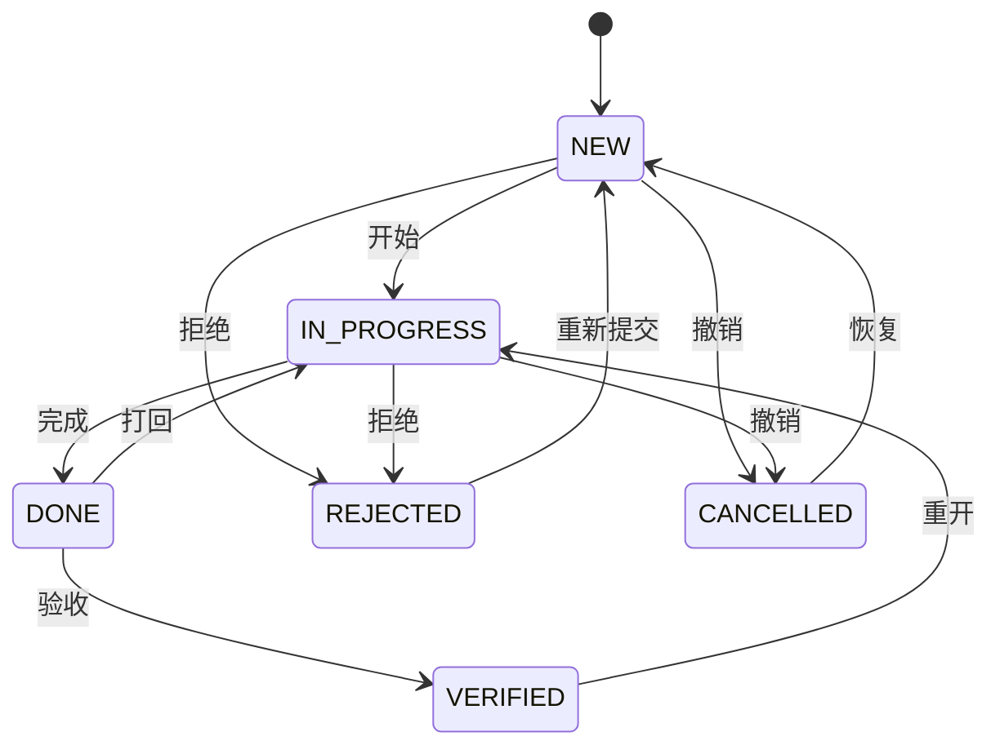

# 05 · 任务状态流转

> 对应 bosun 的 03，规则照搬。实现上把「迁移表」写成**纯函数**模块，事务、加锁、级联放在外层。

## 1. 状态

| 状态 | 含义 | 典型操作者 |
|---|---|---|
| `NEW` | 已创建、未开始 | 人 / Agent 建单 |
| `IN_PROGRESS` | 正在做 | 执行方 |
| `DONE` | 做完、待验收 | 执行方 |
| `VERIFIED` | 验收通过，终态 | 验收方 |
| `REJECTED` | 执行方认为需求不对，拒绝执行 | 执行方 |
| `CANCELLED` | 不需要了（不是需求不对） | 任何人 |

输入不区分大小写，`in-progress` / `in progress` / `reject` / `canceled` 也接受。

## 2. 迁移表

| 从 | 到 | 语义 |
|---|---|---|
| NEW | IN_PROGRESS | 开始（领取） |
| IN_PROGRESS | DONE | 完成 |
| DONE | VERIFIED | 验收通过 |
| DONE | IN_PROGRESS | 打回 |
| VERIFIED | IN_PROGRESS | 重开 |
| NEW / IN_PROGRESS | REJECTED | 执行方拒绝需求 |
| REJECTED | NEW | 提出方改完需求，重新提交 |
| NEW / IN_PROGRESS | CANCELLED | 撤销 |
| CANCELLED | NEW | 恢复 |



其他一律 `{:invalid_transition, from, to, allowed}`，错误信息列出当前可去的状态。另有三条额外检查：

- NEW → IN_PROGRESS：有未满足的依赖时 `{:blocked, [ident]}`（07 §3）。运行开始时的自动领取（§6）不做这项检查——手动、委派等运行本来就不看依赖（13 §4.1），领取时已经决定了要跑；
- CANCELLED → NEW（恢复）：任务还被别的任务替代着（存在指向它的 `replaces` 链）时 `{:replaced, [ident]}`，要先删链再恢复（07 §1）；
- DONE → VERIFIED：任务上有**其他**运行在 `claimed` / `running` / `cancelling` 时 `{:run_active, run}`——等那次运行结束、改动推送之后再验收（15 §4.1 前提 2）。发起这次迁移的运行本身（`scope.run`，例如被唤醒来验收的评审 Agent）不算：否则评审 Agent 永远会被自己的运行挡住。合并则要等包括它在内的所有运行都收尾之后才执行；它收尾时如果又推送了提交，PR head 会偏离 `verified_sha`，合并按 `stale` 处理（15 §4.1）。迁移到 VERIFIED 时历史记下 `verified_sha`（最近一次由运行推送到任务分支的提交，或本地分支最近交付的提交）；「按当前提交重新验收」不改状态，在历史里插入一条 `verified → verified`（`add-pr-reconcile-merge` 决策 10）。

## 3. 实现结构

```elixir
# 纯函数，无数据库访问；StreamData 性质测试覆盖
Helmsman.Tasks.StateMachine.allowed(from)            :: [status]
Helmsman.Tasks.StateMachine.check(from, to, ctx)     :: :ok | {:error, reason}
#   ctx = %{blockers: [ident], replaced_by: [ident], active_run: run | nil, self_verify?: bool, has_passing_tests?: bool}
#   active_run 已排除 scope.run；自动领取时 blockers 传 []（§2）

# 有副作用的一层
Helmsman.Tasks.transition(scope, ident, to, opts)    :: {:ok, task_detail} | {:error, reason}
#   opts = %{comment, commits, tests, feedback}
```

`transition/4` 在一个事务里依次：

1. `Policy.authorize(scope, :transition_task, task)`；
2. 拿维护锁、图锁，`SELECT … FOR UPDATE` 锁任务（01 §4）；
3. 收集 ctx（依赖是否满足、是否自验收、最近一次 → DONE 有没有通过的测试、是否被替代）；
4. `StateMachine.check/3`；
5. 可选：先插一条 Feedback（界面上打回 / 拒绝 / 撤销时填的原因），事件的 `feedback_id` 指向它；
6. 更新 `status`、`assignee_id`（领取时）、`updated_at`，插 `task_events`；
7. Epic 级联（§6）；
8. 派发与代码相关的副作用，同一事务内：按 13 §2 触发运行（打回 / 重开 / 重新提交 / 回调提出方 / 依赖满足）；任务有分支或 PR 时入队 `ReconcilePR(task_id)`（15 §3），由它按任务的当前状态调整 PR、尝试合并；
9. 提交后广播（§7）。

## 4. 历史与完成证据

`task_events` 每次迁移一行：`from_status to_status actor comment commits tests auto feedback_id source_run_id verified_sha inserted_at`。建单时插 `from = nil, to = new` 作为首条。`source_run_id`：迁移发生在哪次托管运行里（用运行令牌调用时自动填）；`verified_sha`：→ VERIFIED 时 PR 的 head（15 §4.1）。

| 字段 | 规则 |
|---|---|
| `commits` | git 提交 hash 列表，每个 7–64 位十六进制、转小写、去重，否则 `{:invalid, :commits, value}` |
| `tests` | `%{command, passed, summary}`，`passed` 必须是布尔，`command` / `summary` ≤ 2000 字 |
| `auto` | 自动流转（Epic 级联、被替代、运行开始时自动领取、CI 失败 / 冲突自动重开）为 true |

约定：→ DONE 时附上 `commits` 与 `tests`，验收方看历史就够，不用翻 Feedback。

## 5. 角色与自验收

- **提出方** = `created_by`；**执行方** = `assignee`；**验收方** = 把任务置为 VERIFIED 的 actor，不限定是谁。
- 领取时 `assignee` 为空才写成当前 actor；打回 / 重开不改执行方；进行中撤销时执行方保留。
- **自验收规则**：当前 actor 就是 `assignee` 时，DONE → VERIFIED 必须有通过的测试证据——本次 `tests.passed == true`，或最近一次 → DONE 的事件带 `tests.passed == true`；否则 `{:self_verify_requires_tests, assignee}`。

多用户后加一条判断：**同一用户名下的不同 actor 不算「本人」**。比如 `alice` 指派给了 `alice/feature-x`，再由 `alice` 本人验收，这是允许的——人确认 Agent 的工作正是期望的流程。规则只防「同一个 actor 自己说自己做完了」，是流程约束而不是安全边界（03 §4「能防什么」）。

执行方是**小队**时，「本人」扩大为执行方一侧：小队本身、leader 和所有成员（16 §1.3）。

自验收与自动合并的关系：自验收即使带着通过的测试被放行，也**不会**触发自动合并（15 §4.1）——PR 留给独立的验收人或在 GitHub 上手动合并。

## 6. 自动流转

### Epic 随步骤

步骤迁移时，在同一事务里同步 Epic 的状态（不经迁移表）：

- 全部步骤都在 DONE / VERIFIED / CANCELLED，且至少一个 DONE / VERIFIED → Epic 自动 → DONE（从 NEW / IN_PROGRESS），备注 `all steps completed (auto)`；
- 已 DONE / VERIFIED 的 Epic 因步骤重开不再满足上一条 → 自动 → IN_PROGRESS，备注 `step reopened (auto)`；
- CANCELLED / REJECTED 的 Epic 不参与；
- 自动事件的 actor 是触发步骤迁移的人，`auto = true`，`commits` / `tests` 为空。

步骤挂上 / 摘下（`update` 改 `epic_id`、建单时带 `epic`）时同样重算一次相关的 Epic。

### 被替代

建 `replaces` 链时，被替代的任务若在 NEW / IN_PROGRESS 则自动 → CANCELLED，备注 `replaced by <ident>`（见 07）。被撤销的任务若是某个 Epic 的步骤，照常触发上面的 Epic 重算。

### 运行开始时自动领取

托管 Agent 的运行进入 `running`，而任务还是 NEW、这个 Agent 是执行方 → 自动 NEW → IN_PROGRESS，actor = 该 Agent（13 §7）。只做这一步；DONE 由 Agent 自己按工作流迁移，并附上 `commits` / `tests`。

### CI 失败、合并冲突时自动重开

任务 VERIFIED 后自动合并失败（CI 失败或有冲突）→ 自动 VERIFIED → IN_PROGRESS，actor = 系统身份 `helmsman`，同时写一条 `review` Feedback 说明原因（15 §5）。这是迁移表里已有的「重开」，只是由系统发起：`Tasks.auto_reopen/2`（`add-continuation-triggers` 决策 11）只在任务仍是 VERIFIED、且最近一次验收仍是触发它的那次时执行，历史记下 `auto_reason`（`ci_failed` / `merge_conflict`），并照常按 13 §2.1 的「打回 / 重开」触发执行方的修复运行。

## 7. 广播

`project:<id>` 发 `{:task_updated, summary}`；`task:<id>` 发 `{:task_transitioned, event}`；有 Epic 级联时 Epic 的两个主题也各发一次。

## 8. 接口

- MCP：`transition_task(task_id, to, comment?, commits?, tests?, actor?)`
- REST：`POST /api/v1/w/:slug/tasks/:id/transition` → 200 详情；409 `invalid_transition`（`detail.allowed`）/ `blocked`（`detail.blockers`）/ `replaced`（`detail.replaced_by`）/ `run_active`（`detail.run`）/ `self_verify_requires_tests`（`detail.assignee`）
- 界面：见 09 §3
