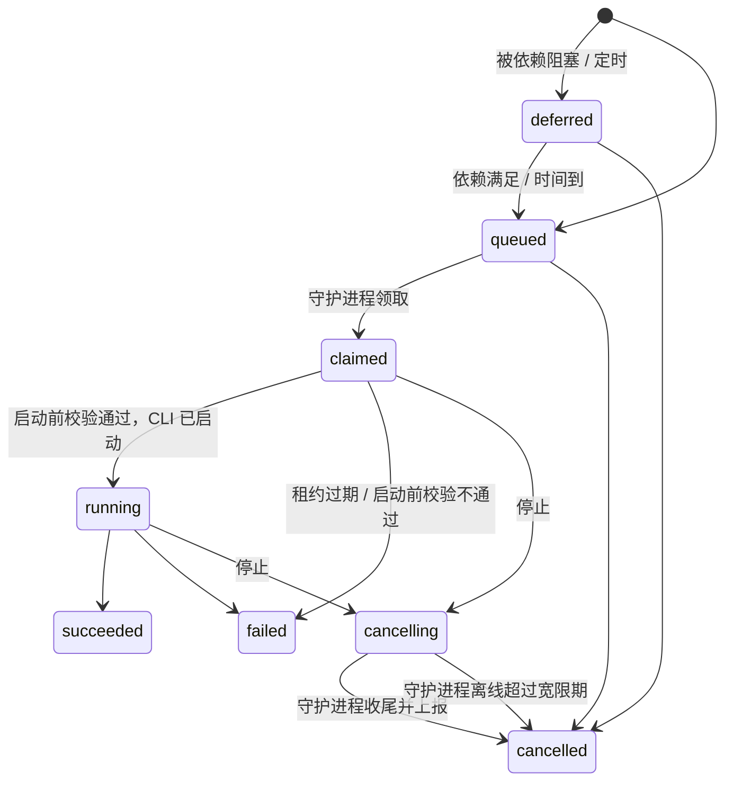

# 13 · 运行与派发

> 「派发」= 某个事件发生时，服务端为托管 Agent 建一条**运行**；绑定的运行时领取它，守护进程调起 CLI 执行（14），结果写回任务。
> 运行和任务是两回事：一张任务可以有很多次运行；运行成功结束**不等于**任务完成，任务状态仍按 05 的状态机走。

## 1. 运行（`runs`）

| 列 | 说明 |
|---|---|
| `workspace_id`、`agent_id`、`runtime_id` | 运行时在建运行时从 Agent 配置里取快照 |
| `task_id` | 可空：自动化的「仅运行」模式没有任务（16 §2） |
| `squad_id` | 以小队 leader 身份运行时填写（16 §1）；决定提示词里用哪份小队说明、`delegate` 能派给谁 |
| `lane` | `work`（做任务本身）\| `reply`（回应一条提及），见 §3 |
| `status` | 见 §4 |
| `triggers jsonb` | 触发原因列表：`[%{kind, by_actor_id, initiator_user_id, causal_agent_ids, instructions, feedback_id, at}]`；每条记下自己的授权来源与因果链，合并后可能有多条（§3） |
| `root_initiator_user_id` | 授权来源：这次运行最终是替谁干活。人引起的是这个人；托管 Agent 在运行中引起的，取引起它的那次运行的 `root_initiator_user_id`（不是 Agent 的所属用户）；延续类继承（§2.2）。领取时会重新校验 |
| `causal_agent_ids bigint[]` | 触发链上经过的所有 Agent（含自己），用于防循环（§7）和自动合并的独立性判断（15 §4） |
| `capabilities text[]` | 这次运行的 `hmr_` 令牌能做什么（§2.3）；入队时按 Agent 配置与运行类型计算，领取时按当时的配置重算，合并时不合并 |
| `priority smallint` | 取任务优先级（high 3 / medium 2 / low 1）；自动化运行为 1 |
| `attempt` / `auto_retries` / `retry_of_id` | 第几次尝试 / 自上次人工重试以来的自动重试次数（§5 的上限按它算）/ 重试自哪条 |
| `not_before` | 重试退避、自动化定时 |
| `daemon_id` | 领取它的守护进程；之后只接受这个守护进程对它的上报 |
| `session_id` | CLI 返回的会话 ID，同一运行时上的后续运行用来恢复会话（14 §4） |
| `repository_id` / `local_repository_id` / `branch` / `base_sha` / `head_sha` / `push_status` / `rescue_branch` / `push_commits` / `pushed_at` | 领取时的仓库与任务分支；本次运行开始前与推送的提交、推送结果（`none` / `pushed` / `conflict` / `failed`，14 §7）、推送冲突时的救援分支、提交列表。出处、`verified_sha` 的依据与待合并的救援分支都由此查出（15 §4.1），不另建 `task_branches`。迟到的推送（运行已被判结束）同样记录 |
| `summary` | Agent 最后一条输出（截断到 4 KB） |
| `usage jsonb` | 输入 / 输出 / 缓存 token 数、费用估算（CLI 给了才有） |
| `failure_reason` / `error` | 失败原因码（§5）与原始错误信息 |
| `claimed_at` `started_at` `finished_at` `last_event_at` | |

**一条运行只会被领取一次。** 领取后出了任何问题（租约过期、机器离线），这一条就以失败结束，需要的话另建一条新运行（§5）。所以旧守护进程迟到的上报只会撞上一个已结束的运行，直接被拒绝，不需要额外的版本号。

`run_events`：`run_id`、`seq`、`type`（守护进程上报的归一化事件，取值以 `HelmsmanProtocol.Event.types/0` 为准：`text` `thinking` `tool_call` `tool_result` `usage` `session` `result` `error` `status`，14 §4）、`data jsonb`、`at`。主键 `(run_id, seq)`，守护进程重发不会重复。保留到运行结束后 30 天，由每天的清理任务按运行整块删除（`runs.events_pruned_at` 记下已清理）；不分区——PostgreSQL 要求分区表的主键含分区键，而去重必须按 `(run_id, seq)`。`runs` 本身永久保留（`add-run-lifecycle` 决策 1、17）。

## 2. 触发规则

所有触发都在**引起它的那个写事务里**判断并插入运行（01 §4），提交后才通知守护进程。所以不会出现「状态改了，运行没建」，也不会因为重试而重复建。

### 2.1 触发表

**新发起**——授权来自触发者（12 §2.1、§2.2）：人直接操作时是这个人；托管 Agent 在运行中引起的（@提及、委派、在运行里建任务并指派）是那次运行的授权来源。目标是小队时，触发者必须能触发这个小队（16 §1.1）：

| 触发 | 条件 | lane | 运行要做什么 |
|---|---|---|---|
| **指派** `assign` | 任务的执行方被设为托管 Agent 或小队（建单时或修改时），任务在 NEW / IN_PROGRESS，且没有勾选「暂不开始」 | work | 完成这个任务 |
| **提及** `mention` | 一条新的有效 Feedback 里 @了托管 Agent 或小队（作者不是该 Agent 自己） | reply | 回应这条 Feedback，**不改变**执行方 |
| **委派** `delegated` | 小队 leader 调用 `delegate`（16 §1.2） | work | 按 leader 的指示做 |
| **手动** `manual` | 界面上的「运行」按钮、MCP / REST `run_agent` | work | 按附带的说明做 |
| **自动化** | 定时 / 手动 / webhook（16 §2） | work | |
| **插话兜底** `steer` | 人写 Feedback 时插话正在运行的托管 Agent（§8），且这条 Feedback 没有为该 Agent 排上别的触发 | 与被插话的运行相同 | 处理这条 Feedback；被插话的运行成功结束且有回执时，领取前移除（`add-run-steering` 决策 5、7） |

**延续**——是之前某次授权的继续，授权**继承**自该任务上这个 Agent 最近一次「指派」（或委派）的授权来源，而不是那个碰巧改了状态的人：

| 触发 | 条件 | lane | 运行要做什么 |
|---|---|---|---|
| **打回 / 重开** `reopen` | 执行方是托管 Agent 或小队，任务 DONE → IN_PROGRESS 或 VERIFIED → IN_PROGRESS（包括 CI 失败、合并冲突导致的自动重开，15 §5） | work | 按评审意见修改 |
| **重新提交** `resubmit` | 同上，任务 REJECTED → NEW | work | 看改过的需求，重新评估 |
| **回答** `answer` | 新的 `answer` 让 `open_question` 变为 false，而那条 `question` 是托管 Agent 写的 | 与提问那次运行相同 | 带着答案继续（恢复会话）；授权继承**提问所在的运行**（提问的 Agent 不一定是执行方，`add-continuation-triggers` 决策 3） |
| **回调提出方** `requested` | 任务的提出方是托管 Agent（且 `wake_on_requested`），任务变为 DONE（等它验收）、REJECTED（需求被拒），或执行方提了 `question` | work（在被提出的那个任务上） | 验收 / 修改需求 / 回答问题；授权继承它**建这个任务时**所在运行的授权来源（建任务时记为 `task_grants` 的 `requested`） |
| **依赖满足** `unblocked` | 见 §2.4 | work | 同「指派」 |
| **委派完成** `delegate_done` | 委派出去的运行结束 | work | leader 决定下一步 |

引起延续或提及的身份就是目标 Agent 自己时不触发（例如执行方 Agent 自己把任务改回 IN_PROGRESS）。系统身份写的 Feedback 不引起提及、回答与回调；触发结果保存在引起它的 Feedback 上（`feedback.dispatch`），界面据此把被拒的提及置灰并说明原因。

为什么要继承：否则一个 `owner_only` 的 Agent 做完后，换成验收人打回、或提问被别人回答，都会因为「这个人无权触发它」而卡住；反过来如果直接放开，又会让任何能改任务状态的人借道触发别人的 Agent。

不触发的情况：

- 触发者（§2.2）无权触发该 Agent 或小队（新发起，12 §2.1、16 §1.1）或继承来的授权已失效（延续，见 §2.2）：只记录，界面和 MCP 说明原因。
- 任务在 VERIFIED / CANCELLED / REJECTED（`resubmit` 除外）：指派不产生运行。
- Agent 已归档、运行时被禁用。

### 2.2 授权来源

- 每条运行记录 `root_initiator_user_id`：
  - 人引起的新发起（界面，或用 `hm_` Token 调 MCP / REST，包括代表 Token 用户的外接 Agent）：这个人；
  - 托管 Agent 在运行中引起的新发起（@提及、委派、在运行里建任务并指派）：**引起它的那次运行的** `root_initiator_user_id`，而不是该 Agent 的所属用户。否则 bob 指派了 alice 的 Agent A，A 再 @alice 的 `owner_only` Agent C，bob 就借道触发了 C。这条只适用于运行能力允许的触发（`write_task`、`delegate`、`create_tasks`，§2.3）；运行令牌调 `run_agent` 一律 `forbidden`，不存在「运行里手动触发」；
  - 延续：继承（§2.1）。
- 新发起时按这个用户校验能否触发目标：Agent 按 12 §2.1，小队按 16 §1.1。
- 领取时重新校验：这个用户仍是工作区成员（member 以上）、仍有权触发该 Agent、Agent 未归档。合并过的运行逐条复核触发的授权来源，丢弃失效的；最早的那条被丢弃时改用剩下最早的一条的授权来源与因果链；全部失效 → 运行取消，原因 `unauthorized`。以小队 leader 身份的运行只校验 leader；成员在被委派时各自校验（16 §1.2）。
- 授权来源用户被移出（或退出）工作区时，在同一事务里停止以他为授权来源的全部运行，不论 Agent 属于谁、是否还合并了别人的触发：排队中的取消、已领取或运行中的转为 `cancelling` 走正常停止流程，原因 `unauthorized`，不自动重试；降为 viewer 不在此列（`add-run-lifecycle` 决策 26）。
- **授权记录**（`task_grants`）：执行方被设为托管 Agent、且授权来源有权触发它时，记下「任务 × Agent」的授权来源与因果链——不论是否勾选了「暂不开始」。延续类触发从这里继承授权；执行方变化时该任务原有的指派授权全部作废，无权的指派不留记录（`add-run-dispatch` 决策 6）。托管 Agent 在运行中建任务时另记一条 `requested` 授权（授权来源与因果链取自那次运行），供「回调提出方」继承，不随执行方变化作废；回答继承提问所在的运行，不查授权记录（`add-continuation-triggers` 决策 3、5）。

### 2.3 运行的能力范围

`hmr_` 令牌不是「所属用户的全部权限」，而是按这次运行需要授予（`capabilities`）：

| 能力 | 缺省 | 包含 |
|---|---|---|
| `read` | 总是 | 读工作区里的项目、任务、反馈、检索、BQL |
| `write_task` | 有任务的运行 | 只对**本次运行的任务**：写 / 修订 Feedback（含 @其他 Agent）、状态迁移、改字段、建 / 删以它为一端的链（不能用 `replaces` 撤销另一张未结束的任务，07 §5） |
| `create_tasks` | 小队 leader、Agent 配置里勾选了的 | 建新任务（新任务的提出方是这个 Agent，§2.1「回调提出方」由此而来） |
| `delegate` | 小队 leader 运行 | 16 §1.2 |

其余（改别的任务、触发 `run_agent`、停止运行、建项目、任何管理动作）一律不允许，返回 `forbidden` 并说明缺哪个能力。这样一次被提示词注入的运行，影响面限制在它自己的任务上。

### 2.4 依赖未满足时

任务有未满足的依赖（07 §3 的定义：有仓库的项目要求前置任务的 PR **已合并**，本地仓库模式要求它交付的分支**已合并**，否则要求 DONE / VERIFIED）时，「指派」类运行建为 `deferred`，`triggers` 里注明 `blocked_by`。前置任务满足条件时（迁移事务里，或 PR 合并、本地分支变为已合并的处理里），把不再被阻塞的 `deferred` 运行改为 `queued`。

配合 Epic，这就是一条流水线：把一组步骤分别指派给不同的 Agent，用 `depends_on` 串起来，前一步合并后下一步自动开工，并且基于已经包含前一步代码的基础分支。

## 3. 去重与合并

两条 lane 分开排队：`work` 是做任务本身，`reply` 是回应提及。这样被依赖阻塞的指派不会把一条提及也拖住，反过来提及也不会把被阻塞的指派提前放出来。

- 同一个 `(task, agent, lane, squad_id)` 已有 `deferred` / `queued` 的运行时，新的触发**并进去**（追加到 `triggers`），不新建行。部分唯一索引兜底：`UNIQUE (task_id, agent_id, lane, coalesce(squad_id, 0)) WHERE status IN ('deferred','queued')`（`squad_id` 随 `add-squads` 加入）。
- 合并时：运行的 `root_initiator_user_id` 保持最早一条触发的；`causal_agent_ids` 取各触发链的并集（只会让防循环与自动合并的独立性判断更保守）；`priority` 取较高者；能力不合并（§1）。防循环只检查新触发自己的链。
- 重试同样走合并：已有排队的就把「重试」追加进去，没有才新建（`retry_of_id` 唯一，防止同一条失败被重试两次）。
- 合并时状态取更「急」的：`deferred` 的行并入一个立即可跑的触发后变为 `queued`（例如被阻塞的指派又收到「手动运行」）。
- **同一任务同一时刻最多一个运行在执行**（不论哪个 Agent、哪条 lane）：它们共用一个代码分支（15 §2），并发会互相踩。不同任务之间完全并行。

**领取时重新校验**排队中的运行，已经失效的取消（原因 `obsolete`）：任务已 CANCELLED / VERIFIED（`reply` lane 除外）、执行方已换成别人（`work` lane 的指派类）、Agent 已归档、运行时已禁用，以及 §2.2 的授权校验。

## 4. 状态



| 状态 | 含义 |
|---|---|
| `deferred` | 等依赖满足或等到 `not_before` |
| `queued` | 等运行时领取 |
| `claimed` | 已被领取，正在准备工作目录 |
| `running` | CLI 正在执行 |
| `cancelling` | 已要求停止，等守护进程中断 CLI、保存改动 |
| `succeeded` | CLI 正常结束且改动已推送（不代表任务完成） |
| `failed` | 出错、超时、机器离线、推送失败 |
| `cancelled` | 已停止 |

### 4.1 领取

守护进程收到 `runs_available` 提示（或每 30 秒自查一次）后请求领取。服务端：

1. 空闲槽位由服务端算：守护进程的 `max_concurrency` 减去它名下 `claimed` / `running` / `cancelling` 的运行数，不信任客户端上报的值；同一个守护进程的并发领取用 `pg_try_advisory_xact_lock(k_daemon)` 串行。
2. 按批扫描候选，直到填满槽位或没有候选：

```sql
SELECT r.* FROM runs r
 WHERE r.runtime_id = ANY($runtime_ids) AND r.status = 'queued' AND r.not_before <= now()
 ORDER BY r.priority DESC, r.inserted_at, r.id
 LIMIT 50
 FOR UPDATE SKIP LOCKED
```

3. 对每条候选，按顺序 **try** 拿锁，拿不到就跳过（不等待，01 §4）：
   - 工作区维护锁（共享）——工作区正在导入时拿不到，不派发；
   - 任务锁 `k_task(task_id)`，拿到后确认这个任务没有 `claimed` / `running` / `cancelling` 的运行；
   - Agent 配置行 `FOR UPDATE SKIP LOCKED`，拿到后数一下它的活跃运行，未超过 `max_concurrency`。
4. §3 的重新校验；运行里**只有**指派类触发（指派、打回、重新提交、依赖满足）时再检查一次依赖——排队后又加了依赖的，改回 `deferred`。含有手动运行、委派等人或 leader 明确发起的触发时不看依赖。
5. 通过的改为 `claimed`、记下 `daemon_id`、签发 `hmr_` 令牌，返回运行描述（14 §3）。

`SKIP LOCKED` 加上全部 `try` 锁，让多个守护进程并发领取互不阻塞，也不会和任务写操作互相等待。

### 4.2 启动前校验

准备工作目录（克隆、建 worktree）可能要几分钟。守护进程准备好之后、**启动 CLI 之前**发 `starting`，服务端在一个事务里再做一次 §3 的校验：

- 通过 → `claimed → running`，回复继续；
- 不通过（这几分钟里任务被撤销、执行方被换等）→ 运行 `failed(obsolete)`，回复放弃，守护进程不启动 CLI。
- 复核读到的成员、Agent、配置、任务、运行时行都在这个事务里按 01 §4 的顺序加锁，与修改它们的写入串行；领取时同样复核，但只用 try / `SKIP LOCKED`，正被修改的候选留在队列里（`add-run-lifecycle` 决策 24）。
- 回复丢失后守护进程会重发 `starting`：服务端按 `started_at` 返回与第一次相同的决定，不重复副作用（`add-run-lifecycle` 决策 23）。

### 4.3 租约与心跳

- `claimed` 超过 10 分钟没有 `starting` → `failed(lease_expired)`，令牌吊销；原运行的触发并入一条新的 `queued` 运行（不计入重试次数）。
- `running` / `cancelling` 期间守护进程每 30 秒上报一次心跳；运行时离线超过宽限期（12 §3.4）→ `failed(runtime_offline)` 或 `cancelled`。
- 守护进程重启后在 `join` 里上报自己认为仍在跑的运行：服务端对不上的（已结束、不是它领的）让它立即终止；反过来，服务端认为它在跑、它却没有列出的 → `failed(daemon_restart)`（`cancelling` 的 → `cancelled`）。心跳同样对账，但只收回领取超过 60 秒的（心跳可能在领取回复到达前就已组好）。上报中仍在 `cancelling` 的运行再推一次 `cancel`。
- 领取后被停止（`cancelling`）的运行，`starting` 时直接回复放弃并记为 `cancelled`。
- 这些检查由 Oban 定时任务做（每分钟一次）。

### 4.4 任务侧的副作用

运行状态的变化先在**只锁运行行**的事务里提交（条件更新：`WHERE id = $1 AND daemon_id = $2 AND status = $expected`，更新不到就说明是迟到的上报，直接拒绝）；任务侧的副作用再在之后的事务里按任务写的锁顺序执行，并且按 `(run_id, 副作用类型)` 幂等：

| 副作用 | 何时 | 幂等键 |
|---|---|---|
| NEW → IN_PROGRESS（§7） | `running` 之后 | `task_events` 部分唯一 `(source_run_id) WHERE auto AND from_status = 'new' AND to_status = 'in_progress'` |
| 兜底回帖（§7） | `succeeded` 之后 | `feedback` 部分唯一 `(source_run_id) WHERE fallback` |
| 唤醒 leader（`delegate_done`） | 委派运行结束之后 | 触发记录里的 `run_id` |
| 开 / 更新 PR（15 §3） | `pushed` 之后 | Oban 唯一键 |
| 重新对账 PR（15 §3、§4.1：等待中的合并） | 运行从 `claimed` / `running` / `cancelling` 进入任一终态的同一事务里（任务所在项目绑定了 GitHub 仓库时；`Runs.after_terminal/1`，`add-pr-reconcile-merge` 决策 4） | Oban 唯一键 |
| 插话结算（§8） | 运行以 `succeeded` 结束、且有已回执的插话 | Oban 唯一键（`steer_settle`） |

## 5. 失败与重试

| 原因码 | 含义 | 自动重试 |
|---|---|---|
| `runtime_offline` | 执行中机器离线 | 是，最多共 2 次 |
| `daemon_restart` | 守护进程重启后回收 | 是，最多共 2 次 |
| `lease_expired` | 领取后迟迟没启动 | 是，不计次数 |
| `timeout` / `stalled` | 超过总时长 / 长时间无输出（12 §2） | 是，最多共 2 次 |
| `provider_network` | CLI 到模型服务的网络错误 | 是，最多共 3 次，间隔 30 秒 |
| `provider_rate_limit` | 限流 | 重试一次，间隔 5 分钟 |
| `provider_auth` `provider_quota` | CLI 未登录 / 额度用尽 | 否 |
| `cli_missing` `cli_version` | 找不到 CLI / 版本太旧 | 否 |
| `workspace_prepare` | 克隆、建 worktree 失败 | 否 |
| `push_conflict` | 远端分支被别人动过，改动推到了救援分支（14 §7） | 是，下一次运行先合并救援分支 |
| `push_failed` | 推送失败（网络、权限），改动留在本机 | 是，同一运行时优先 |
| `context_overflow` | 上下文超出模型窗口 | 否；人工重试时开新会话 |
| `obsolete` `unauthorized` | 校验不通过（§3、§2.2） | 否 |
| `cli_error` / `unknown` | 其他 | 否 |

自动重试在运行结束提交之后由后台任务入队（与 Agent 改绑、运行时禁用串行；Agent 不可用、未绑定或运行时已禁用时不重试，`add-run-lifecycle` 决策 25）。重试按 §3 合并进排队中的运行，`attempt + 1`；沿用原运行的授权来源与触发（领取时复核），排到 Agent 当前绑定的运行时；能恢复会话就恢复。「最多共 N 次」按 `auto_retries` 计；`push_conflict` / `push_failed` 上限 2。人工重试（界面按钮）不受次数限制（`auto_retries` 归零）；同一条运行的重试已结束后不能再对它重试（`retry_of_id` 唯一）。

## 6. 提示词

提示词由**服务端**生成（守护进程只负责传给 CLI），保证同一版本的服务端行为一致。英文模板的定稿见 `add-run-lifecycle` 决策 10。提示词用**英文**，与 MCP 工具描述、错误文本一致；Agent 的 `instructions` 和 Feedback 原文照原样放入，不翻译。下面的示例为了便于阅读写成中文。结构：

```
<Agent 的 instructions>
<小队说明与成员名单（仅 leader 运行）>

---
你是 Helmsman 工作区 acme 里的 Agent「keel/dev」。Helmsman 的 MCP 服务器（名为 helmsman）已经配置好，身份已固定，不需要 identify。
协作规则见 MCP 资源 helmsman://workflow，必须遵守。你只能修改任务 BOS-12。

本次运行：任务 BOS-12（项目 BOS）。
触发原因：alice 把它指派给了你。            ← 按 triggers 逐条列出，例如：
                                           ← 「bob 在 BOS-12#5 提到了你：<原文>」
                                           ← 「你在 BOS-12#3 的提问已由 alice 回答：<原文>」
                                           ← 「验收被打回，评审意见 BOS-12#7：<原文>」
                                           ← 「CI 失败：<检查名与摘要>」
代码：当前目录是仓库 acme/app 的工作区，分支 hm/7/bos-12（基于 main）。
  提交你的改动，但不要 push、不要开 PR、不要切换分支——这些由 Helmsman 负责。

开始前先调用 get_task("BOS-12") 读取完整需求、历史和反馈。
```

- 各种触发行的英文定稿：指派、手动、重试见 `add-run-lifecycle` 决策 10；打回 / 重开（含 CI 失败、合并冲突）、重新提交、回答、回调提出方、提及见 `add-continuation-triggers` 决策 9。
- 任务正文、历史、全部反馈**不**塞进提示词，让 Agent 自己用 `get_task` 取：提示词保持短小（Copilot CLI 的提示词走命令行参数），也避免把可能过期的快照当真。触发它的那条 Feedback 例外，原文直接放进去。
- 恢复会话时省略 instructions 和通用部分，只发「触发原因」那一段。
- 没有关联仓库的项目：工作目录是一个空的临时目录，「代码」一段改为说明这一点。

## 7. 任务状态联动与防循环

服务端只做两件事，其余由 Agent 按工作流自己推进（`transition_task` / `add_feedback`）：

1. 运行进入 `running` 时，若任务还是 NEW，且这个 Agent 是执行方（或执行方是小队、而这次运行正是以该小队 leader 身份运行的）：自动 NEW → IN_PROGRESS（actor = 该 Agent，`auto = true`）。
2. 运行**成功结束**时，若这次运行里没有任何 `source_run_id` 指向它的 Feedback（运行令牌写入的 Feedback 都会自动填 `source_run_id`）：把它最后的输出（`summary`）以该 Agent 的名义写成一条 `comment`，`fallback = true`。失败的运行不写，失败原因显示在运行卡片上。

任务的 → DONE 事件记下当时所在的运行（`task_events.source_run_id`），自动合并据此判断「验收的是不是那次运行交付的代码」（15 §4）。

运行失败不改任务状态；任务上显示最近一次运行的状态，BQL 可以查 `run = failed`（10）。

防止 Agent 之间互相触发无限循环：

- `causal_agent_ids` 的来源：
  - 人引起的新发起：只有目标 Agent 自己；
  - Agent 引起的新发起（@提及、委派、在运行里建任务并指派）：引起它的那次运行的链 + 目标 Agent；
  - 延续：继承授权来源那次运行的链 + 目标 Agent。例如「回调提出方」继承提出方当初建任务那次运行的链，**不会**把执行方加进来——提出方 Agent 被唤醒去验收执行方的工作，本来就是独立的评审（15 §4.1）。
- 链长超过 5，或者新发起的目标 Agent 已经在链上（A → B → A），不再触发，并在任务上留一条系统备注。
- 同一任务每小时最多 20 次运行（可按工作区配置），超出的触发只记录不执行。
- Agent 不会被自己写的 Feedback 触发。

## 8. 停止与插话

- **停止**：界面按钮、MCP / REST `cancel_run`。`queued` / `deferred` 直接 → `cancelled`；`claimed` / `running` → `cancelling`，通知守护进程中断 CLI（14 §6）。守护进程把已有改动提交并推送后上报，运行 → `cancelled`。守护进程不在线时，宽限期后直接 → `cancelled`。
- 改执行方、改任务状态**不会**停止正在跑的运行；界面在这些操作旁边提示可以手动停止。
- 自动停止只发生在：Agent 被停用 / 归档、Agent 所属用户被移出工作区、运行的授权来源用户被移出工作区（§2.2）。
- **插话**（`add-run-steering`）：人在任务上写 Feedback 时，如果有 Agent 正在跑（`running`），输入框下方出现「同时发给正在运行的 keel/dev」（缺省勾选）。
  - 只有人能插话（MCP 的写入身份总是 Agent），且作者必须有权触发该 Agent（与提及同一标准）；否则 Feedback 照常保存，插话结果记为 `skipped`。只在追加 Feedback 时可用，修订与迁移原因不行。
  - 这条 Feedback 照常记在任务上，照常按 §2 产生触发；它为该 Agent 产生的触发标记 `steer_run_id`，一条都没排上队时另加一条 `steer` 触发（§2.1，授权来源 = 作者、lane 与被插话的运行相同）作为兜底。
  - 运行在 `running` 且兜底已排上队时，提交后服务端把一段英文说明加原文推给守护进程（记入 `run_steers`），守护进程交给 CLI 适配器送进当前会话；CLI 确认收下后守护进程上报回执（`acked_at`），回执先于 `finished` 落库。守护进程重连（`join`）时服务端重推没有回执的插话，守护进程按 Feedback 去重。实时送达与兜底同进同退：兜底被频率上限、运行时不可用等规则拒绝时不推送，插话整体不发生，结果说明原因。
  - **结算**：被插话的运行**成功结束**且有回执，标记了它的兜底触发才移除（副作用 `steer_settle` 主动移除，领取时的复核再兜一次；一条不剩的排队运行以 `obsolete` 取消）。只有回执、运行却失败或被停止的，兜底保留——回执只说明 CLI 收下了，不说明处理完了。
  - 不支持运行中追加输入的 CLI（Copilot CLI、Cursor；Claude Code 以实测为准）或没收到回执 → 兜底保留，当前运行结束后接着跑。所以一条插话不会丢，送达且处理完的也不会再跑一次。

## 9. 实时与界面

- 主题 `run:<id>`：状态变化与事件流；`task:<id>`：该任务的运行列表变化；`workspace:<id>:runs`：Agent 忙闲、队列长度。
- 任务详情页右栏「运行」卡片：进行中的在上，历史折叠；每条显示触发原因、Agent、状态、耗时、分支 / PR、用量。点开是实时滚动的执行记录（文本、工具调用、工具输出），以及停止 / 重试按钮。
- 任务列表与详情页头：有 Agent 在跑时显示「keel/dev 正在处理」。
- 查看执行记录需要 member 以上（记录里可能有代码和命令输出）。

## 10. 接口

- 领域：`Helmsman.Runs.enqueue/3`（只由触发器和手动入口调用）、`claim/2`、`starting/2`、`append_events/3`、`pushed/3`、`finish/3`、`cancel/2`、`retry/2`、`steer_ack/3`（守护进程回执）、`steerable/2`（界面是否显示插话勾选框）；插话本身是 `Helmsman.Feedback.add/3` 的 `steer_run_id`（`add-run-steering`）。
- MCP：`run_agent(agent, task_id?, instructions?)`、`list_runs(task_id)`、`cancel_run(run_id)`。
- REST：`/api/v1/w/:slug/runs`、`/runs/:id`、`/runs/:id/events`、`/runs/:id/cancel`、`/runs/:id/retry`。
