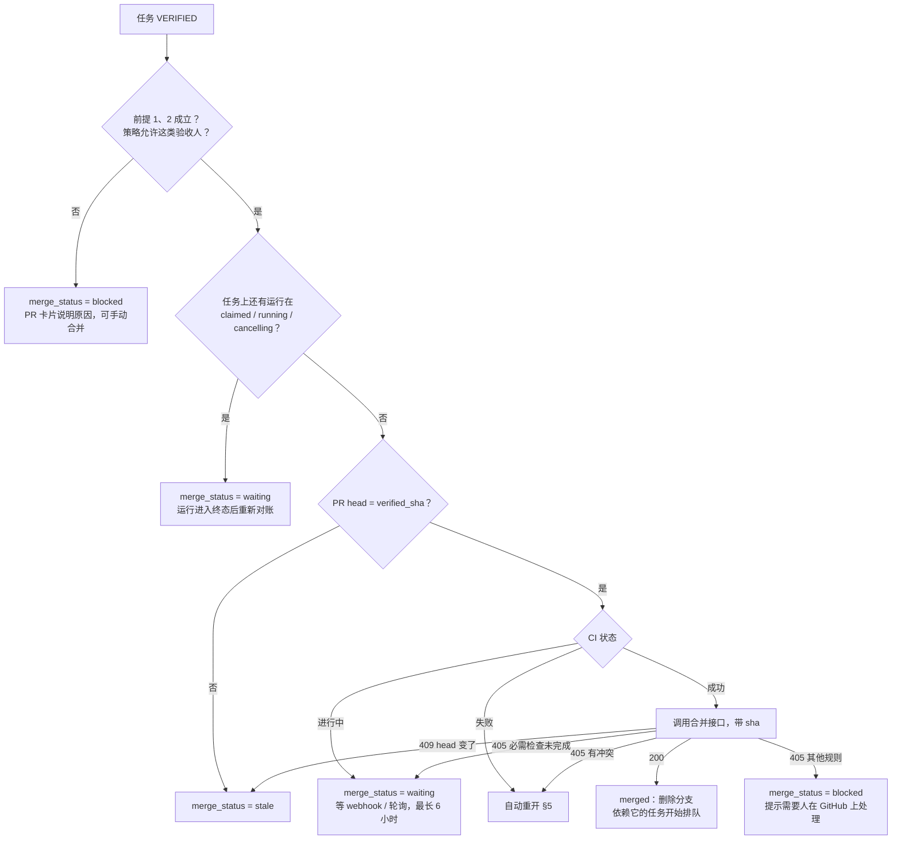

# 15 · GitHub 集成：分支、PR 与自动合并

> 目标：Agent 写的代码以 PR 的形式交付，任务验收（VERIFIED）后由 Helmsman 自动合并。人不需要在本地手动合并。
> 首期只支持 **github.com**。GitHub Enterprise Server 需要按主机区分 App、安装和仓库 ID（它们只在单个主机内唯一），GitLab / Gitea 以后按同一套接口加。

## 1. 接入方式：GitHub App

用 GitHub App 而不是个人令牌：权限可以收窄到具体仓库，令牌短期有效，合并记录显示为 App 而不是某个人。

| 项 | 说明 |
|---|---|
| App 本身 | 每个 Helmsman 实例一个。实例管理员在 `/admin/github` 用 GitHub 的 App manifest 流程一键创建，App ID、私钥、webhook 密钥、OAuth client 加密存库（`github_apps`）；也可以用环境变量 `GITHUB_APP_ID` / `GITHUB_APP_PRIVATE_KEY` / `GITHUB_WEBHOOK_SECRET` / `GITHUB_APP_CLIENT_ID` / `GITHUB_APP_CLIENT_SECRET` 提供（环境变量优先）。App 必须开启「安装时请求用户授权（OAuth）」，见「安装」 |
| 权限 | Contents 读写、Pull requests 读写、Checks 只读、Commit statuses 只读、Metadata 只读。**不**申请 Administration：不预读分支保护规则，以 GitHub 合并接口的响应为准（§4） |
| Webhook | `pull_request`、`check_suite`、`check_run`、`status`、`repository`（改名、转移、归档、默认分支变化）、`installation`、`installation_repositories` → `POST /webhooks/github`。校验 `X-Hub-Signature-256`；按 `X-GitHub-Delivery` 去重；先落库入队再异步处理。安装与仓库事件只作为「重新读取」的信号，不应用负载里的值（乱序无害） |
| 安装 | 工作区 admin 在 `/w/:slug/settings/github` 点「连接 GitHub」，跳到 GitHub 安装页选择组织和仓库，回调后把这次安装关联到工作区。一个安装只能关联一个工作区。**回调里的 `installation_id` 不可信**（任何人都能拼一个别人的安装 ID）：App 开启安装时的用户授权，回调带回 `code`，服务端换成用户令牌，只有该安装出现在 `GET /user/installations` 里才关联，用户令牌随即丢弃。「断开」只解除本地关联（仓库标记为不可用，项目的绑定保留），不在 GitHub 上卸载 App；重新连接同一安装即恢复 |

API 调用用 Req 直接访问 REST / GraphQL；App 身份用 RS256 JWT（JOSE）换安装令牌，安装令牌缓存到过期前 5 分钟。所有调用都在 Oban 任务里执行，失败按 GitHub 的限流头退避重试。

## 2. 仓库与分支

- 安装覆盖的仓库同步到 `repositories`。项目在设置里绑定**一个**仓库，并选择基础分支（缺省是仓库的默认分支）。不绑定仓库的项目照常可用，运行在空目录里（14 §5）。
- **一个任务一个分支**：`hm/<工作区 ID>/<ident 小写>`，如 `hm/7/bos-12`，从项目的基础分支建出（带工作区 ID：同一仓库可能先后属于两个工作区——断开后重新安装可关联到别的工作区——而 ident 只在工作区内唯一；slug 可改，所以不用 slug）。同一任务的所有运行（不论哪个 Agent、哪台机器）都在这条分支上接着做——远端分支是唯一的事实来源，所以换机器也能继续（14 §7）。
- 推送冲突时守护进程把改动推到救援分支 `hm/7/bos-12-run-<id>`，服务端记录下来，下一次运行准备时合并（14 §7）。PR 合并后删除**已并入合并结果**的救援分支；没并入的保留（它可能是这些改动唯一的副本）；任务撤销或拒绝时不删任何分支（`add-pr-reconcile-merge` 决策 7）。
- 推送令牌：领取运行时，服务端为这一个仓库签发安装令牌，只给 `contents: write`，1 小时有效；只交给守护进程，不交给 Agent（14 §5）。

## 3. PR 的生命周期

**一个任务一个对账任务**：所有与 PR 有关的变化（任务迁移、守护进程上报 `pushed`、该任务上的运行进入终态、webhook、定时轮询）都只做一件事——入队 `ReconcilePR(task_id)`（Oban 唯一键 = task_id，已排队的就不重复排）。它每次都读**当前**的任务状态、最近的验收事件和 GitHub 上 PR 的**实际**状态，算出该做什么再做，做完再读一遍确认。这样：

- 事件乱序、重复都没关系（webhook 只是唤醒信号，内容不直接写库）；
- 旧的「合并」请求不会在任务已经重开之后执行——执行时它看到的是重开后的状态。

对账的目标状态：

| 任务 / 上报 | PR 应该是 |
|---|---|
| 有过 `pushed`，还没有 PR | 开 PR：`hm/7/bos-12` → 基础分支；标题 `BOS-12: <任务标题>`；正文是任务链接、需求摘要、「由 Helmsman 管理」说明 |
| 任务在 NEW / IN_PROGRESS | draft |
| 任务在 DONE | 可评审（GraphQL `markPullRequestReadyForReview`） |
| 任务在 VERIFIED | 可评审，并按 §4 尝试合并 |
| 任务在 CANCELLED / REJECTED | 关闭（不删分支，方便以后恢复） |
| GitHub 上已被人直接合并 / 关闭 | 只记录，不改任务状态，任务详情页显示出来 |

一个任务可以先后有多个 PR：合并后任务又被重开、又有**不在合并内容里**的新推送时开新 PR。已合并的 PR 记下 `included_sha`——确认包含在合并内容里的最近一次推送（合并时 PR 的头部就是它、或经 compare 确认是它的后代，压缩 / 变基合并同样成立；人在 PR 上补了提交再合并不会误开新 PR），依赖规则（07 §3）据此判断代码是否已进入基础分支（`add-pr-reconcile-merge` 决策 21）；「当前 PR」是项目**当前绑定的仓库**里最新的一个，依赖规则（07 §3）与 PR 卡片都看它。PR 的身份是「仓库 + 编号」，请求一律发往 PR 记录自己的仓库；项目改绑仓库后，旧仓库里的 PR 脱离管理（不再转草稿、关闭或合并，由人处理），推送记录与 `verified_sha` 也只看当前仓库（`add-pr-reconcile-merge` 决策 20）。每次开新 PR 之前先找回「已创建、未记录」的开着的 PR。Helmsman 自己关闭的 PR（任务撤销 / 拒绝）在任务恢复后重新打开；别人在 GitHub 上关闭的不动，只记录。标题与基础分支只在创建时设定。草稿不受支持的仓库开普通 PR。对账的完整规则见 `add-pr-reconcile-merge` 决策 5–7。

`task_pull_requests` 记录：`task_id`、`repository_id`、`number`、`url`、`branch`、`state`（draft / open / merged / closed）、`head_sha`、`checks_state`（pending / success / failure）、`merge_status`（none / waiting / stale / merged / blocked / failed）、`merge_note`、`merged_sha`、`auto_reopen_count`。任务详情页右栏有 PR 卡片：状态、CI、合并进度、原因、链接。

PR 合并后：记下合并的同一事务里插入 `ReleaseDependents`，提交后在图锁下复查依赖它的任务（以及依赖它所属 Epic 的任务），满足条件的 `deferred` 运行开始排队（13 §2.4）。

## 4. 合并策略

项目级设置 `merge_policy`：

| 值 | 行为 |
|---|---|
| `on_verified`（**缺省**） | 任务 VERIFIED 后自动合并；验收人可以是人，也可以是独立的 Agent（如专职评审 Agent） |
| `on_verified_human` | 同上，但只有**人**验收才触发合并；Agent 验收的需要人在 GitHub 上合并 |
| `manual` | 只开 PR，不自动合并 |

另有 `merge_method`（`squash` 缺省 / `merge` / `rebase`）、`require_ci`（缺省 true：没有任何检查跑过时不合并）、`delete_branch_after_merge`（缺省 true）。

### 4.1 前提（缺一不可）

**1. 验收是独立的。** 判断依据是这条分支的**出处**，而不是当前的执行方字段（执行方和小队成员都可以事后修改）：

- 出处 = 所有往这条分支推送过提交的运行的 Agent，加上这些运行的 `causal_agent_ids`（触发链上的 Agent）；
- 验收人不能在出处里；验收人是 Agent 时，它验收所在运行的 `causal_agent_ids` 也不能和出处有交集——开发 Agent 自己 @ 来的评审 Agent 不算独立；
- 执行方是小队时，小队的 leader 和成员也不算独立（16 §1.3）。执行方一侧取「验收时记下的」（`task_events.assignee_side_ids`）与「对账时的」并集：同一次验收不会因为事后移出成员、换 leader 或改派而变成独立，要放行只能由执行方一侧以外的人或 Agent 重新验收（`add-squads` 决策 11）。

执行方带着测试自验收（05 §5）是允许的，但不独立，**不会**触发自动合并。

**2. 验收的就是交付的那一版。**

- 任务上有**其他**运行在 `claimed` / `running` / `cancelling` 时不能验收（05 §2 `{:run_active, …}`；发起验收的运行本身除外）——避免「Agent 先把任务置 DONE、守护进程还没推送」时被验收；
- 验收时记下 `verified_sha` = 最近一次由运行推送到任务分支的 `head_sha`（迁移事务里不访问 GitHub；正常时它就是 PR 的 head。有人手动往分支推过提交时 PR head 与它不同 → `stale`，而手动推的提交也不能被「重新验收」，只能手动合并，`add-pr-reconcile-merge` 决策 15）；
- **推送链完整**：从 `verified_sha` 那条推送记录往回，每条推送记录的 `base_sha` 必须是同一任务另一条推送记录的 `head_sha`，或基础分支上的提交；「在基础分支上」用 compare 接口判断（`base...sha` 为 `identical` / `behind`）；断开说明有一段提交的出处没记下（守护进程的待推送账本丢失或一直没补发，`add-daemon-git-workspace` 决策 17），按出处不完整处理，不自动合并；
- **合并要等运行全部收尾**：验收可以在评审 Agent 自己的运行里发生（上一条的例外），但合并（自动合并和 §6 的「立即合并」）要求任务上**没有任何** `claimed` / `running` / `cancelling` 的运行，包括验收所在的那次运行——它收尾时可能还会自动提交并推送（14 §7）。有活跃运行时 `merge_status = waiting`；运行进入终态后重新对账（§3），先重读 PR head：与 `verified_sha` 不同 → `stale`，相同才继续往下走。合并成功之前不删分支。
- 合并请求带 `sha = verified_sha`：验收之后又有新推送，GitHub 会拒绝（409）。这时 `merge_status = stale`，PR 卡片提示「验收后有新提交」，有验收权限的人可以点「按当前提交重新验收」（记一条 `review` Feedback 并更新 `verified_sha`）。

**3. CI 通过。** head 上所有 check run 和 commit status 都已完成且成功；`require_ci` 时至少要有一个。分支保护里还有尚未上报的必需检查时，GitHub 的合并接口会拒绝，按「进行中」处理。

**4. 可合并。** 没有冲突，没有被分支保护的其他规则挡住（例如要求人工 approve）。

### 4.2 流程

`ReconcilePR` 在任务为 VERIFIED 时：

合并前再读一次任务：仍是 VERIFIED、最近的验收事件仍是触发这次合并的那一条、仍没有活跃运行，否则什么都不做。405 再细分：重读 PR，`mergeable_state = dirty` 为冲突；必需检查未完成为「进行中」；其余为 `blocked`。GitHub 还在计算可合并性（`mergeable = null`）时先不合并，30 秒后再对账。CI 等待按 `waiting_since` 计时，轮询间隔随等待时间从 1 分钟增长到 15 分钟。

## 5. 自动重开：让 Agent 自己修

CI 失败或合并冲突时，不需要人介入：

- 以工作区的系统身份（`helmsman`，03 §1）写一条 `review` Feedback：失败的检查名、摘要和链接；或说明有冲突、下一次运行会把基础分支合进来（GitHub 的接口不给冲突文件列表，文件由运行准备时的 `git status` 呈现给 Agent）；
- 任务 VERIFIED → IN_PROGRESS（`auto = true`），PR 转回 draft；
- 执行方是托管 Agent 或小队时，这次重开按 13 §2.1 触发一次运行（授权继承原来的指派），提示词里带上失败信息；冲突的情况，守护进程准备工作区时先把基础分支合进来，冲突留给 Agent 解决（14 §7）；
- Agent 修好后照常 → DONE，再由验收人 → VERIFIED，重新走合并流程。

同一 PR 自动重开最多 3 次（`auto_reopen_count`，可配置）。超过后不再重开，`merge_status = failed`，改为以系统身份写一条 @提出方的 `question`（同一次验收只写一次；系统身份的 Feedback 不唤醒 Agent），等人处理。

## 6. 权限

| 动作 | 谁 |
|---|---|
| 连接 / 断开 GitHub 安装 | 工作区 owner、admin |
| 项目绑定仓库、改合并策略 | 工作区 owner、admin |
| 「按当前提交重新验收」 | 能验收这个任务的人（member 以上），同样要满足 §4.1 前提 1；PR 当前 head 必须是运行推送的提交。记一条 `review` Feedback，并在历史里插入一条 `verified → verified`（成为新的「最近的验收」） |
| PR 卡片上「立即合并」「重试合并」 | 同上；**与自动合并检查完全相同的前提**（立即合并只放行合并策略，记为对当前这次验收的合并请求）。工作区 owner 可以跳过前提 1（独立性），必须填写原因，记为一条系统 Feedback。Agent 身份一律不能操作 |
| 看 PR 卡片 | 所有成员 |

## 7. 测试

- GitHub API 用 `Req.Test` 打桩，按录制的真实响应回放；webhook 用固定的签名样本，并测试乱序、重复投递。
- `ReconcilePR` 的决策做成纯函数（输入：任务状态、验收事件、出处、PR 实际状态、检查结果、策略 → 输出：动作），表驱动覆盖所有分支。
- 端到端：本地起一个假的 Git 远端（bare repo）+ 打桩的 GitHub API，跑完「指派 → 运行 → 推送 → 开 PR → DONE → VERIFIED → 合并 → 依赖任务开工」。

## 8. 本地仓库模式

不在 GitHub 上的代码（内网仓库、本机试用）可以用**某台守护进程机器上的本地仓库**（`add-local-repositories`）：

- **登记在机器上**：机器主人在守护进程的 `config.toml` 里登记本地仓库（`helmsman repos add <路径> --name app --workspace acme`），守护进程上报，服务端只在主人开放的那些工作区（按工作区 ID 记录，改 slug 不影响）里登记为 `local_repositories`；撤销开放后该工作区的绑定保留但不可用。路径只在机器上配置，服务端只用名字；路径只对机器主人与 owner / admin 可见。机器主人也可以在本机设置允许的根目录（`[repos] allowed_roots`，只能在机器上改，缺省为空即关闭），之后在运行时页登记 / 移除自己机器上的仓库：守护进程列出根目录下的 git 仓库（限深度与数量、不跟随符号链接，只返回相对路径与名字），登记时守护进程重新校验路径在根内（逐级 `lstat`、git 目录也须在根内）后写入配置，效果与 `helmsman repos add` 相同；只有机器主人能做，工作区 owner / admin 也不行；每次操作记入 `local_repository_changes`（`add-local-repo-web-registration`，协议 7）。
- **一个项目一台机器**：项目在 GitHub 仓库与本地仓库之间二选一（owner / admin 绑定）。没有远端在机器之间同步分支，所以只有该仓库所在守护进程上的运行时能执行这个项目的运行，别的机器领到会以 `workspace_prepare` 失败。
- **先复制再交付**：守护进程把用户仓库 fetch 到 `~/.helmsman/repos/local/<name>.git`，在缓存的任务 worktree（分支 `hm/<工作区 ID>/<ident>`）里执行；收尾时不强推地把分支推进用户仓库（在用户仓库一侧的 receive-pack 命令里强制 `receive.denyCurrentBranch=refuse`、不运行 hook，用户自己设了 `updateInstead` 也不会改动其工作区），被拒就推救援分支。用户仓库只会多出 `hm/<工作区 ID>/…` 分支，工作区、`HEAD`、其他分支与 hook 都不受影响。出处、待推送账本与 GitHub 模式相同（14 §7）。
- **审查与合并都由人在本地做**：没有 PR、CI 与自动合并，§4 的合并策略与前提不适用；验收照常（VERIFIED 时记下最近交付的提交）。任务详情的「本地分支」卡片给出审查与合并命令。
- **合并状态**：守护进程定期检查任务分支的提交是否已进入基础分支（`repo_status`），检测到即记为已合并；压缩合并、变基合并检测不到，由人「标记为已合并」。已合并、且记录的就是最近一次交付的本地分支让依赖它的任务满足条件（07 §3）；变为已合并（自动检测或人工标记）与取消标记时同样插入 `ReleaseDependents` 复查依赖方（13 §2.4）。Helmsman 不删用户仓库里的分支。
