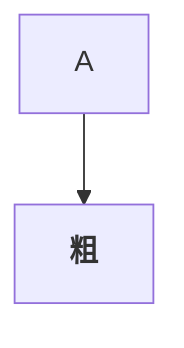

# 样例文档

一段**粗体**、*斜体*、~~删除线~~与 `行内代码 #BOS-1 @keel/dev`。参见 #bos-1、BOS-2#3、#BOS-999 与 x#BOS-1。

@KEEL/DEV. 请看；@alice 不在名单里。自动链接 www.example.com 与 <https://example.com/a?b=1&c=2>，邮件 bob@example.com。

> 引用里的 #BOS-2 与 @keel/dev
>
> - 嵌套列表

1. 第一
2. 第二
   - [x] 已完成
   - [ ] 待办

| 列 A | 列 B |
|:-----|-----:|
| #BOS-1 | `#BOS-1` |
| [链接 #BOS-1](https://example.com/doc "标题") |  |

脚注一[^1]，脚注二[^note]，再次[^1]，脚注三[^1-2]。

[^1]: 说明里提到 #BOS-2。
[^note]: 第二条说明。
[^1-2]: 名称像重复引用的脚注。

[](https://example.com/page) 与 [](https://example.com/ci)

```elixir
defmodule Sample do
  def hello(name), do: "hi #{name}"
end
```



```nosuchlang
x <y> & z
```

<script>alert(1)</script>

<div style="color:red" onclick="x()">原始 HTML</div>

[危险](javascript:alert(1))  <!-- 注释 -->

---
